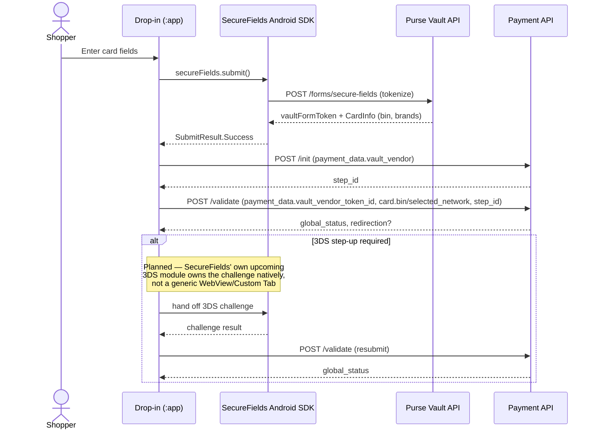
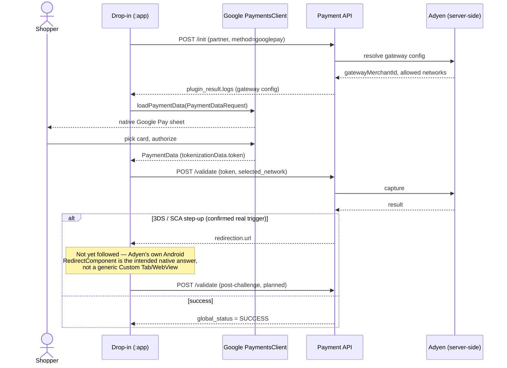
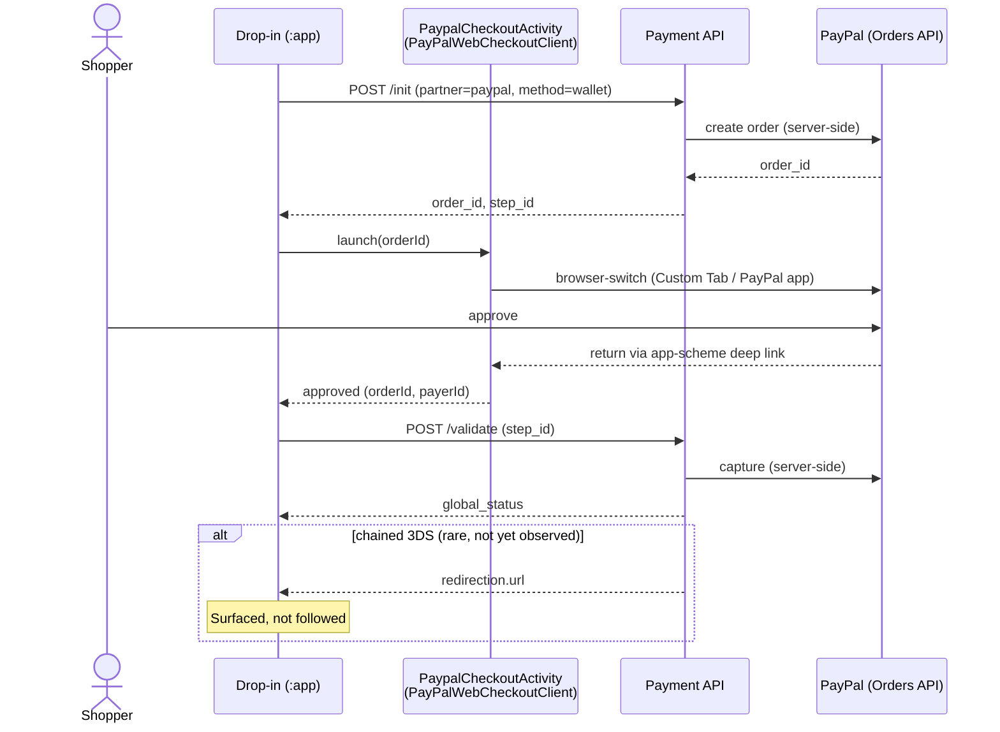
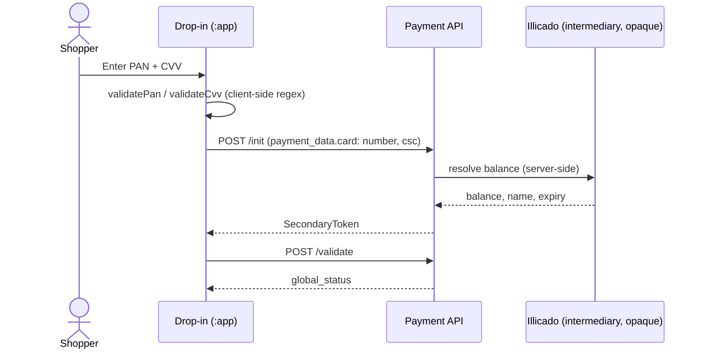

# Payment Flow Diagrams

Sequence diagrams for the four methods this POC handles — CB, Google Pay, PayPal, Illicado — see
[Payment Methods](../integration/payment-methods.md) for the prose version of each and [Redirect
Handling](redirect-handling.md) for the redirect contract each diagram's dashed `alt` branch
refers to. Solid arrows are implemented calls; the `alt`/`note` branches marked **not yet
followed** are surfaced today ([`WalletValidationResult`](../../partner-ui/src/main/kotlin/eu/purse/dropin/partnerui/partner/paypal/wallet/WalletValidationResult.kt),
[`GooglePayValidationResult`](../../partner-ui/src/main/kotlin/eu/purse/dropin/partnerui/generic/googlepay/GooglePayValidationResult.kt))
but not acted on — see [Pain Points Recap](../decisions/pain-points-recap.md).

---

## CB (`purse`/`creditcard`, via SecureFields Android)

**Status:** implemented end to end — capture (SecureFields tokenization) then `/init`+`/validate`
via `CardMapper`, mirroring usp-widget's `purse` vault bridge (see [Payment Methods —
CB](../integration/payment-methods.md#cb-full)). The `vault_vendor_token_id` payload shape (a
top-level `payment_data` field, not nested under `card`) is confirmed against
`purseCreditCardBridge.submitForResult` in `usp-widget/packages/partner-ui/src/plugins/vaults/purse/creditcard/bridge.ts` —
no longer a guess, see [Pain Points Recap, point 9](../decisions/pain-points-recap.md).

---

## Google Pay (`{partner}/googlepay`, e.g. `adyen`)

**Status:** implemented end-to-end for the non-3DS path (see [Partner:
adyen](../partners/adyen.md#implemented-android)). This is the one method in scope with a
**confirmed, not hypothetical**, live redirect trigger on web today. `DropinAndroid.getSessionTransactions()`
(`GET /sessions/{sessionId}`, Purse's own published re-query-as-source-of-truth pattern) exists in
the SDK but isn't auto-fired after this flow — see [Session &
Protocols](session-and-protocols.md#init-and-validate) for the standalone alfred debug tool instead.

---

## PayPal (`paypal`/`wallet`, via the official PayPal Android SDK)

**Status:** implemented end-to-end on a device against a PayPal-enabled sandbox order — see
[Partner: paypal](../partners/paypal.md#implemented-android). Whether the backend's order creation
actually threads an app-return target through (vs. a fixed merchant web URL) is unconfirmed — [Pain
Points Recap, point 4](../decisions/pain-points-recap.md). `DropinAndroid.getSessionTransactions()`
(`GET /sessions/{sessionId}`, Purse's own published re-query-as-source-of-truth pattern) exists in
the SDK but isn't auto-fired after this flow — see [Session &
Protocols](session-and-protocols.md#init-and-validate) for the standalone alfred debug tool instead.

---

## Illicado (`illicado`/`giftcard`, secondary — no SDK, no redirect)

**Status:** `/init` (tokenization) works today; no redirect code path exists anywhere in the
reference implementation for this method, and none is expected — but that's an acknowledged blind
spot behind the Illicado intermediary, not a confirmed absence — see [Partner:
illicado](../partners/illicado.md#redirection-study).

---

## See also

- [Payment Methods](../integration/payment-methods.md)
- [Redirect Handling](redirect-handling.md)
- [Pain Points Recap](../decisions/pain-points-recap.md)
