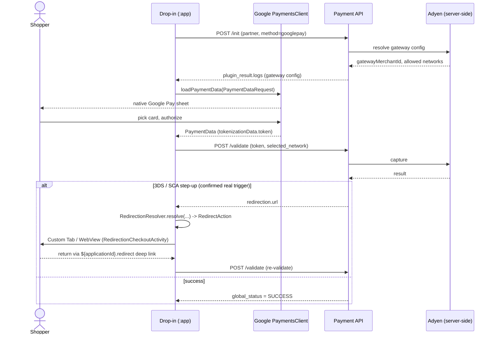

# Partner: `adyen`

Backs **Google Pay** (`googlepay`) in this POC. **Implemented** end to end on Android using
Google's own Google Pay API (`com.google.android.gms:play-services-wallet`) — no Purse-specific
SDK, no redirect for the sheet itself.

---

## Table of Contents

- [Role in this POC](#role-in-this-poc)
- [Implemented (Android)](#implemented-android)
- [Sequence diagram](#sequence-diagram)
- [Documentation](#documentation)
- [Redirection study](#redirection-study)
- [See also](#see-also)

---

## Role in this POC

The sample session used to write [Session &
Protocols](../architecture/session-and-protocols.md) has `googlepay` under `adyen`, and that's
the partner this page documents — but note the Google Pay integration on web is not
Adyen-specific code. `packages/partner-ui/src/plugins/generics/googlepay/index.ts` is a **generic
plugin**, reused across any partner that offers `googlepay` (Adyen, or others) — there is no
`adyen-googlepay`-specific folder. Treat this page as documenting "Google Pay as currently wired
in the reference implementation," which happens to be under Adyen in practice, not "something
uniquely true of Adyen."

## Implemented (Android)

Built in `:partner-ui` (`eu.purse.dropin.partnerui.generic.googlepay`) as a **generic** package —
mirroring web's `plugins/generics/googlepay` — reused across any partner offering `googlepay`, not
an Adyen-specific one. Orchestrated by `:dropin`'s `DropinAndroid` and triggered from Google's own
branded `PayButton` (`com.google.android.gms.wallet.button.PayButton`, rendered in the demo
`:app`'s method list next to the PayPal button). The flow ports web's generic `googlepay` plugin
(`getGooglePayConfiguration` + `onButtonClicked` in `usp-widget/packages/partner-ui/src/plugins/generics/googlepay`):

1. **`/init`** — `DropinAndroid.createGooglePayRequest()` → `POST /init` for `adyen`/`googlepay`
   (`GooglePayMapper.buildInitPayload`). Unlike PayPal's `client_id` (a session-level
   `merchant_specifics` field), the gateway config needed for Google's `PaymentDataRequest` —
   `gatewayMerchantId`, allowed card networks, merchant id/name — comes back from **this response**
   (`plugin_result.logs.payment_methods`, an Adyen-specific JSON-encoded array; ports
   `partners/adyen.ts`, with a `partners/default.ts`-style fallback for any other `googlepay`
   partner reading `logs.payment_method_configuration`). This is the Google Pay analogue of
   PayPal's `order_id`.
2. **Sheet** — the app builds Google's `PaymentDataRequest` JSON from that config plus the
   session's amount/currency (`GooglePayMapper.buildPaymentDataRequestJson`) and calls
   `PaymentsClient.loadPaymentData()` (`GooglePayClient`, wrapping `Wallet.getPaymentsClient`) —
   Google's own native payment sheet, no WebView. The result routes back via Google's own
   `TaskResultContracts.GetPaymentDataResult` `ActivityResultContract`, registered in
   `DropinActivity` — no custom return Activity or deep link needed, unlike PayPal's browser-switch.
3. **`/validate`** — on success, `PaymentData.toJson()`'s `paymentMethodData.tokenizationData.token`
   (plus the selected `cardNetwork`) is submitted via `DropinAndroid.validateGooglePay(...)` →
   `POST /validate` (array body; ports web's `preValidation`/`getAdyenSession` shape: the token
   travels as a JSON-encoded string in `partner_data.session`), reading `global_status` into a
   `GooglePayValidationResult`.

**No manifest work for the integrator:** the required
`com.google.android.gms.wallet.api.enabled` meta-data ships in this module's own manifest and
merges into the app.

**Still open / not built here:**
- The `/validate` response's chained 3-D Secure `redirection` (see [Redirection
  study](#redirection-study) below) is now **followed**: `GooglePayMapper`/`GooglePayValidationResult`
  resolve it into a `RedirectAction` via `eu.purse.dropin.partnerui.redirect.RedirectionResolver`,
  and `DropinActivity` opens it via `RedirectionCheckoutContract` (Custom Tabs for a GET, WebView
  for a POST form), re-calling `/validate` on return. Untested on a device against a real 3DS
  challenge — see docs/decisions/pain-points-recap.md.
- `countryCode` in the `PaymentDataRequest` isn't modeled anywhere in the session/
  `MethodConfiguration` today; this port hardcodes `"FR"` (matching web's `partners/default.ts`)
  rather than replicating web's Adyen variant, which reuses the UI locale for this field.
- End-to-end tokenization is only exercisable on a device/emulator with Google Play services and a
  test card configured; the unit tests cover the `/init`+`/validate` payload/parse contract
  (`GooglePayMapperTest`).

## Sequence diagram

**Status:** implemented end-to-end for the non-3DS path (see [Implemented
(Android)](#implemented-android) above). This is the one method in scope with a **confirmed, not
hypothetical**, live redirect trigger on web today. The 3DS branch above is now wired
(`RedirectionResolver`, `RedirectionCheckoutActivity`/`Contract` in `:partner-ui`) but has never
been exercised against a real 3DS-triggering sandbox card — see
docs/decisions/pain-points-recap.md. `DropinAndroid.getSessionTransactions()`
(`GET /sessions/{sessionId}`, Purse's own published re-query-as-source-of-truth pattern) exists in
the SDK but isn't auto-fired after this flow — see [Session &
Protocols](../architecture/session-and-protocols.md#init-and-validate) for the standalone alfred
debug tool instead.

## Documentation

**[docs.adyen.com](https://docs.adyen.com/)** — verified live. Covers Adyen's full API reference,
Google Pay integration guides, and 3D Secure / SCA handling.

## Redirection study

**Today: Google Pay already redirects — its `/validate` step is a confirmed, not just
hypothetical, redirect trigger** (see [Payment Methods — Google
Pay](../integration/payment-methods.md#google-pay-full), which points back here for the
citation). The generic Google Pay plugin explicitly calls the redirect resolver:

- `packages/partner-ui/src/plugins/generics/googlepay/index.ts` (lines ~108-119) calls
  `manageRedirection`, explicitly passing `context.session?.redirection` (the session-level
  fallback field — see [Session & Protocols — Full `LegacyPaymentSession`
  shape](../architecture/session-and-protocols.md#full-legacypaymentsession-shape)) as the
  fallback parameter.
- The Adyen card plugin (`adyen-creditcard/index.ts`, lines ~250-260) does the same — both flows
  route through the exact same generic redirect contract documented in [Redirect
  Handling](../architecture/redirect-handling.md#the-redirect-contract).

**Trigger:** a 3D Secure / SCA step-up challenge after the Google Pay sheet returns its token —
the token itself doesn't guarantee authentication is complete; Adyen can still require a
redirect-based (or, on web, iframe-based) challenge before authorizing.

**Implication for Android:** the *Google Pay sheet* itself doesn't redirect (it's a native
dialog) — but the payment flow as a whole, via Adyen (or whichever partner backs a given
session's `googlepay` entry), already does today. No Google-Pay-specific redirect handling is
needed beyond what [Redirect Handling](../architecture/redirect-handling.md) already specifies —
the Custom Tabs/WebView translation there applies unchanged; this partner just confirms it isn't
an unlikely edge case to skip.

---

## See also

- [Payment Methods — Google Pay](../integration/payment-methods.md#google-pay-full)
- [Redirect Handling](../architecture/redirect-handling.md)
- [Session & Protocols](../architecture/session-and-protocols.md)
