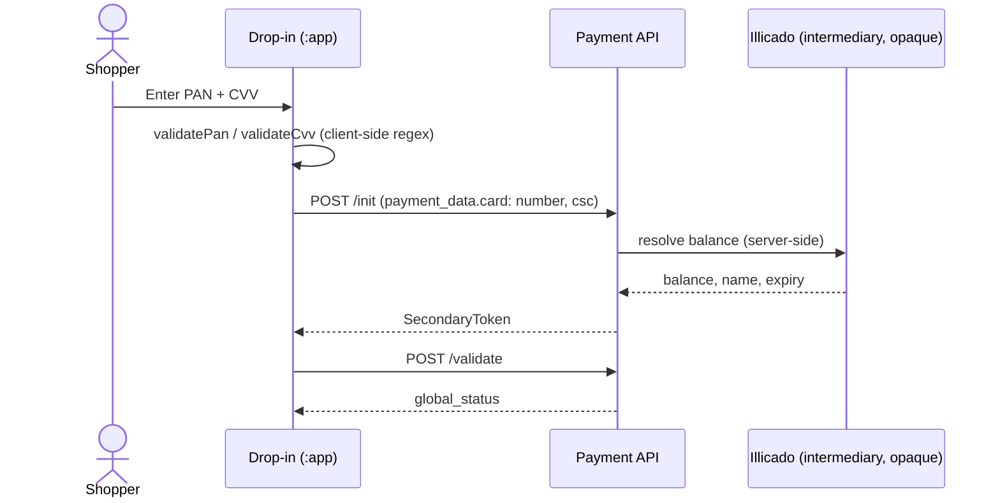

# Partner: `illicado`

Backs **Illicado** (`giftcard`) in this POC — "starter" depth; only needs to appear in the method
list per the acceptance criteria (see [POC Scope](../decisions/poc-scope.md)).

---

## Table of Contents

- [Role in this POC](#role-in-this-poc)
- [Sequence diagram](#sequence-diagram)
- [Documentation](#documentation)
- [Redirection study](#redirection-study)
- [See also](#see-also)

---

## Role in this POC

Unlike every other partner here, Illicado has **no `partner-ui` plugin at all** — confirmed zero
references to `illicado` anywhere under `usp-widget/packages/partner-ui/src/`. It's handled
entirely inside `headless-checkout`'s secondaries layer (PAN + CVV form, no SDK, no iframe — see
[Payment Methods — Illicado](../integration/payment-methods.md#illicado-starter)), which is
exactly why it needs no partner-specific UI plugin: there's no partner-hosted form or SDK to
bridge to.

## Sequence diagram

**Status:** `/init` (tokenization) works today; no redirect code path exists anywhere in the
reference implementation for this method, and none is expected — but that's an acknowledged blind
spot behind the Illicado intermediary, not a confirmed absence — see [Redirection
study](#redirection-study) below.

## Documentation

**None found — and there's a specific reason for that.** Illicado is a French gift-card/loyalty
network; it does not appear to expose a public developer documentation site the way PayPal or
Adyen do:

- `api.illicado.com` returns a 403 — a private partner-admin login surface, not a public API
  docs portal.
- `illicado.com` / `pro.illicado.com` have no API/developer documentation section and are
  bot-walled against casual crawling.
- Illicado only appears **inside other PSPs' own documentation** as a supported payment method
  (e.g. Monext, Worldline, Checkout.com integration guides mention accepting Illicado gift
  cards) — none of those count as Illicado's *own* official documentation, so none are linked
  here as a substitute. If Illicado-specific integration detail is ever needed beyond what
  `usp-widget`'s own PAN-validation logic already encodes (see [Payment Methods —
  Illicado](../integration/payment-methods.md#illicado-starter)), it will likely have to come
  from Purse's own backend/PSP-integration team rather than a public doc, or from whichever PSP
  intermediary Purse routes Illicado transactions through.

## Redirection study

**Today:** no redirect code path exists for Illicado anywhere in the reference implementation —
consistent with it having no partner-ui plugin to begin with. Submission is a plain `/init` then
`/validate` round-trip (see [Payment Methods —
Illicado](../integration/payment-methods.md#illicado-starter)).

**Hypothetical redirect trigger:** none identified from the codebase itself. The only plausible
source would be a step-up authentication requirement imposed by whichever PSP intermediary
actually processes Illicado transactions behind the scenes (per the documentation gap above,
that's not visible from `usp-widget` — Illicado is presented to the widget as a flat PAN+CVV
form regardless of what happens downstream). Nothing in `MethodConfiguration` for `illicado`
(`vault.vendor: "none"` in the one example payload seen) suggests a vault/3DS path exists for it
the way `external_three_ds_enabled` does for card methods.

**Implication for Android:** treat Illicado as genuinely redirect-free for this POC, with lower
confidence than CB or Google Pay's "mostly synchronous, but 3DS is a known exception" — here
there isn't even a known exception to plan for, just an acknowledged blind spot behind a PSP
intermediary this POC has no visibility into. If Illicado is ever taken past "starter" depth in
production, confirm with the backend/PSP-integration team whether the intermediary PSP can impose
a step-up flow, since the client-side code gives no signal either way.

---

## See also

- [Payment Methods — Illicado](../integration/payment-methods.md#illicado-starter)
- [Redirect Handling](../architecture/redirect-handling.md)
- [POC Scope](../decisions/poc-scope.md)
