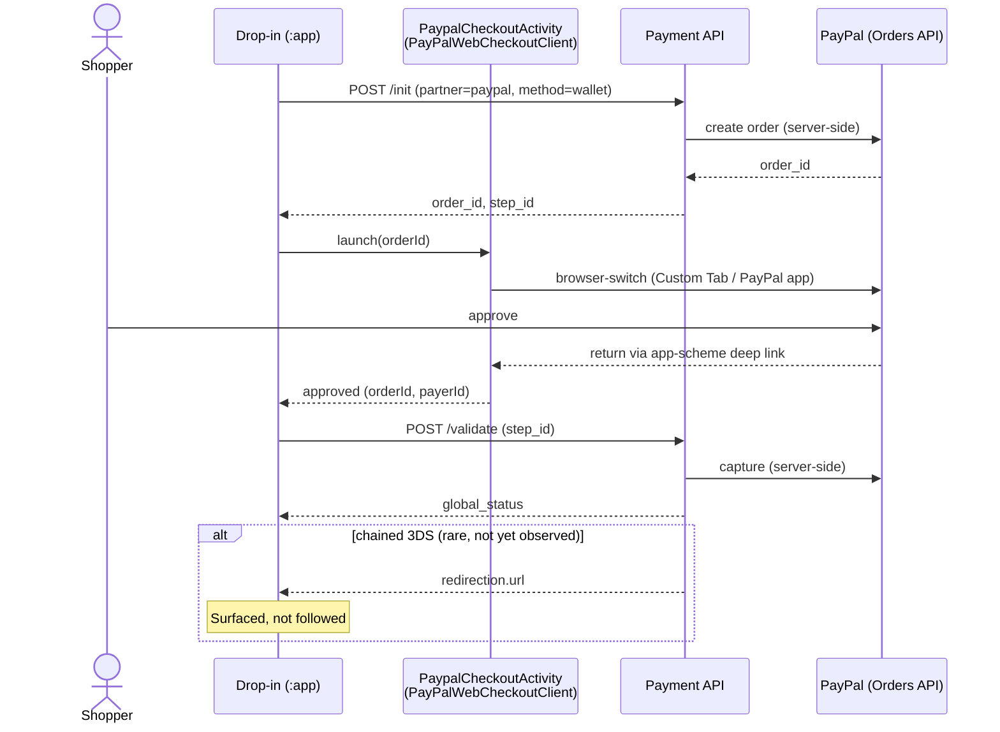

# Partner: `paypal`

Backs **PayPal** (`wallet`) in this POC. **Implemented** end to end on Android via the official
PayPal Android SDK (`com.paypal.android:paypal-web-payments`) — the one method that requires the
buyer to leave and return to the app (the ticket's own open question).

---

## Table of Contents

- [Role in this POC](#role-in-this-poc)
- [Implemented (Android)](#implemented-android)
- [Sequence diagram](#sequence-diagram)
- [Documentation](#documentation)
- [Redirection study](#redirection-study)
- [See also](#see-also)

---

## Role in this POC

`packages/partner-ui/src/plugins/partners/paypal/wallet/index.ts` and
`.../paypal/bnpl/index.ts` — this POC only targets `wallet` (see
[POC Scope](../decisions/poc-scope.md#explicitly-out-of-scope) for why `bnpl`, "Pay Later," is
excluded).

## Implemented (Android)

Built in the `:partner-ui` module (`eu.purse.dropin.partnerui.partner.paypal.wallet`), orchestrated
by `:dropin`'s `DropinAndroid` and triggered from the **official branded PayPal button**
(`com.paypal.android:payment-buttons`'s `PayPalButton`, rendered in the demo `:app`'s method list —
not a custom button). **Wallet pay-now
only** — registration/vaulting is out of scope. The flow mirrors web's paypal plugin, with its
in-page JS-SDK popup swapped for a native browser-switch:

1. **Create order** — `DropinAndroid.createPaypalOrder()` → `POST /init` for `paypal`/`wallet`
   (`PaypalWalletMapper.buildInitPayload`), reading `plugin_result.logs.order_id` + top-level
   `step_id` into a `WalletOrder`.
2. **Approve** — the app launches `PaypalCheckoutContract` (an `ActivityResultContract`), which runs
   PayPal's `PayPalWebCheckoutClient.start(orderId)` inside the self-contained
   `PaypalCheckoutActivity`. PayPal opens its approval (Custom Tab / PayPal app); on return,
   `finishStart()` yields approved / canceled / failed.
3. **Capture** — on approval, `DropinAndroid.validatePaypal(stepId)` → `POST /validate` (array body,
   carrying the init's `step_id`), reading `global_status` into a `WalletValidationResult`.

**Session config used:** `merchant_specifics.client_id` (parsed into
`MethodSettings.merchantClientId`, surfaced as `DropinAndroid.paypalClientId`) for PayPal's
`CoreConfig`; the Purse environment (`PurseEnvironment.PRODUCTION` → PayPal `LIVE`, else `SANDBOX`).

**No manifest work for the integrator:** the return `<intent-filter>` (scheme `${applicationId}`)
ships in `:partner-ui`'s own manifest and merges into the app.

**Still open / not built here:**
- The PayPal order's `return_url` (set server-side at `/init`) must deep-link back to the app's
  scheme (`${applicationId}://…`) for the SDK to catch the return — **needs backend confirmation**.
- A chained 3-D Secure `redirection` in the `/validate` response
  (`WalletValidationResult.redirectionUrl`) is surfaced but not yet followed.
- BNPL ("Pay Later") stays out of scope.
- End-to-end approval is only exercisable on a device against a PayPal-enabled session; the unit
  tests cover the `/init`+`/validate` payload/parse contract (`PaypalWalletMapperTest`).

## Sequence diagram

**Status:** implemented end-to-end on a device against a PayPal-enabled sandbox order — see
[Implemented (Android)](#implemented-android) above. Whether the backend's order creation actually
threads an app-return target through (vs. a fixed merchant web URL) is unconfirmed — [Pain Points
Recap, point 4](../decisions/pain-points-recap.md). `DropinAndroid.getSessionTransactions()`
(`GET /sessions/{sessionId}`, Purse's own published re-query-as-source-of-truth pattern) exists in
the SDK but isn't auto-fired after this flow — see [Session &
Protocols](../architecture/session-and-protocols.md#init-and-validate) for the standalone alfred
debug tool instead.

## Documentation

**[developer.paypal.com](https://developer.paypal.com/)** — verified live; the same root the
codebase itself references (`packages/partner-ui/src/commons/PartnerUI/types.ts` links into
`developer.paypal.com/sdk/js/reference/`). Covers the JS SDK, Orders v2 API, and the classic
redirect-based Checkout flow this POC's proposed Android flow is modeled on (see [Redirect
Handling](../architecture/redirect-handling.md#proposed-paypal-flow-for-this-poc)).

## Redirection study

**Today:** PayPal wallet **does** call a redirect on success —
`context.redirection?.redirectToUrl(context.session!.success!)`, in both
`paypal/wallet/index.ts` (line ~387) and `paypal/bnpl/index.ts` (line ~326) — but only to
navigate to the **merchant's own** `session.success` page, never to a PayPal-hosted URL. The
actual buyer approval happens earlier, in-page, via the PayPal JS SDK's popup — by the time this
redirect fires, approval and capture are already done; it's a plain "go to the confirmation page"
navigation, structurally identical to what CB or Illicado would do on a successful, no-redirect
payment.

**This confirms what [Redirect Handling](../architecture/redirect-handling.md) already
concluded**: there is no PayPal-hosted-page redirect/return contract anywhere in this codebase to
copy. The `settings.merchant_specifics.integration_mode: "redirection"` flag
(`MethodConfiguration`) is read only by `bnpl`'s `ensureClientCompatibility` (lines ~232-245) as
an eligibility gate — it calls `/init` and checks for `NOT_ELIGIBLE`, it does **not** change how
the approval UI itself renders. Even in `"redirection"` mode, `bnpl` still renders its button
in-page today.

**Hypothetical redirect trigger, specific to PayPal:** the actual buyer-facing approval step
itself, which is exactly what has no page-navigation precedent to reuse on native Android (no
popup equivalent exists). This is the one partner in this POC where "hypothetical redirect" isn't
an edge case on top of an otherwise-synchronous flow (as with CB/Google Pay's 3DS) — it's the
*primary* flow needing a redirect-shaped answer at all, which is why [Redirect
Handling](../architecture/redirect-handling.md#proposed-paypal-flow-for-this-poc) proposes Custom
Tabs + an app-returning deep link as the working design, flagged as needing backend confirmation.
On Android this is now implemented via the PayPal Android SDK's own browser-switch (see
[Implemented (Android)](#implemented-android)) rather than a hand-rolled Custom Tab — but the same
backend `return_url` → app-deep-link dependency still applies.

**Implication for Android:** once a PayPal order is approved (via whichever mechanism — Custom
Tabs/deep link, or PayPal's own Android SDK), the follow-up `/validate` call and its own
possible redirect (e.g. a chained 3DS step) still goes through the exact same generic contract as
every other method — PayPal is unusual in *needing* a redirect for approval itself, not in how
it's resolved afterward.

---

## See also

- [Payment Methods — PayPal](../integration/payment-methods.md#paypal-starter)
- [Redirect Handling](../architecture/redirect-handling.md)
- [POC Scope](../decisions/poc-scope.md)
