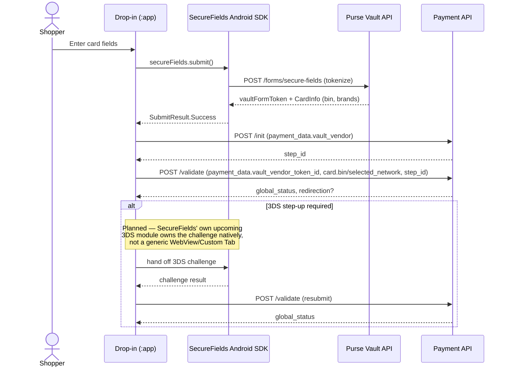

# Partner: `purse`

Backs **CB** (`creditcard`) in this POC — the one method with full depth, via the
[SecureFields Android SDK](../integration/getting-started.md).

---

## Table of Contents

- [Role in this POC](#role-in-this-poc)
- [Why `purse`, not a transacting PSP](#why-purse-not-a-transacting-psp)
- [Sequence diagram](#sequence-diagram)
- [Documentation](#documentation)
- [Redirection study](#redirection-study)
- [See also](#see-also)

---

## Role in this POC

Unlike every other partner in this list, `purse` isn't a third-party PSP — it's Purse's own card
vault, exposed as a `Partner` in its own right
(`Partners.purse = "purse"` in `usp-widget/packages/sdk/src/types.ts`). Card data capture and
tokenization happen entirely inside Purse's infrastructure (on Android: the SecureFields Android
SDK), not inside a PSP-hosted iframe or SDK.

## Why `purse`, not a transacting PSP

[Session & Protocols](../architecture/session-and-protocols.md#session-level-vault-config--where-tenantid-actually-comes-from)
describes finding CB via `configurations.vault.vendor == "purse"` on a `creditcard` entry,
without naming which `protocols` key that entry lives under. Digging further into
`usp-widget`, the evidence points at the entry being **literally `protocols.purse.creditcard`**,
not nested under whichever PSP will eventually settle the transaction:

- `packages/partner-ui/src/plugins/vaults/index.ts`'s `getVaultPlugin` resolves the vault plugin
  **partner-agnostically** by vendor: `creditCardVaults = { pci_proxy: purse_creditcard, purse: purse_creditcard }`
  — the same underlying vault plugin backs both vendors, keyed only by `vault.vendor`, not by
  partner.
- `packages/partner-ui/src/plugins/vaults/vaultExtras.ts` special-cases the `purse` partner
  specifically: `vaultExtras[Partners.purse].creditcard = { skipInit: true }` — a config override
  that only makes sense if `purse` is itself a valid `protocols` partner key for `creditcard`.
- `packages/checkout/src/Partners/plugins.ts` (the older "V3" widget's partner registry)
  registers `purse: { creditcard: () => import('./purse/creditcard') }` as a sibling entry
  alongside `pci_proxy: { creditcard: ... }` — both at the same partner-key level.

**This is strong circumstantial evidence, not a directly observed example.** No e2e fixture or
mock combining `partner: "purse"` with a live `creditcard` entry was found to confirm the exact
real-world session shape. Treat `protocols.purse.creditcard` as the most likely shape for this
POC's target sessions, but verify against a real sandbox session before hardcoding a partner key
into the Android model — the mechanism that matters either way is checking
`configurations.vault.vendor == "purse"`, which is correct regardless of which key it's nested
under.

## Sequence diagram

**Status:** implemented end to end — capture (SecureFields tokenization) then `/init`+`/validate`
via `CardMapper`, mirroring usp-widget's `purse` vault bridge (see [Payment Methods —
CB](../integration/payment-methods.md#cb-full)). The `vault_vendor_token_id` payload shape (a
top-level `payment_data` field, not nested under `card`) is confirmed against
`purseCreditCardBridge.submitForResult` in `usp-widget/packages/partner-ui/src/plugins/vaults/purse/creditcard/bridge.ts` —
no longer a guess, see [Pain Points Recap, point 9](../decisions/pain-points-recap.md).

## Documentation

There is no external developer portal for `purse` the way there is for `adyen` or `paypal` — it
is Purse's own infrastructure. The relevant "documentation" is:

- The sibling **`vault-android`** repository's own docs (`vault-android/docs/`, especially
  `docs/integration/getting-started.md` — a local repo, not a public URL; see this POC's own
  [Getting Started](../integration/getting-started.md), which already builds on it) — covers the
  Android-side SDK that implements this partner's card capture.
- `usp-widget`'s own web vault SDK (`packages/checkout/src/Partners/purse/`), which is the web
  equivalent of what SecureFields Android does — useful if a behavior needs cross-checking against
  the web implementation.

## Redirection study

**Today:** no redirect. SecureFields Android renders native fields, tokenizes in-app, and hands
back a token — the same as the web vault plugin's own hosted-fields-in-page behavior. Neither
implementation has ever needed to leave the page/app for card capture itself.

**Hypothetical redirect trigger:** a 3D Secure (SCA) step-up challenge *after* tokenization,
during the Payment API's `/validate` call — not during card capture. This is modeled generically
by `MethodConfiguration.vault.external_three_ds_enabled` (see
[Session & Protocols — `MethodConfiguration`](../architecture/session-and-protocols.md#methodconfiguration))
and would surface through the same generic `/validate` redirect contract every other method uses
(see [Redirect Handling](../architecture/redirect-handling.md#the-redirect-contract)), not through
any `purse`-specific plugin code — no partner-specific 3DS handling exists to inspect, because
the `purse` vault plugin doesn't own that step; the transacting PSP behind the settlement does.

**Implication for Android:** CB should not be assumed redirect-free just because SecureFields
itself never redirects. The [3DS handling already noted in Payment
Methods](../integration/payment-methods.md#cb-full) — "a CB payment normally resolves
synchronously unless 3DS is triggered" — is the accurate framing; this page just confirms there's
no partner-specific wrinkle on top of the generic contract for the `purse` vault path
specifically. Whichever PSP settles the transaction behind a `purse`-vaulted card is what would
determine actual 3DS likelihood in a real merchant session — information this POC's session data
alone won't surface.

---

## See also

- [Getting Started](../integration/getting-started.md)
- [Payment Methods — CB](../integration/payment-methods.md#cb-full)
- [Redirect Handling](../architecture/redirect-handling.md)
- [Partners — aci](README.md#partners-considered-but-out-of-scope) *(the `pci_proxy`-vendor sibling, out of scope)*
