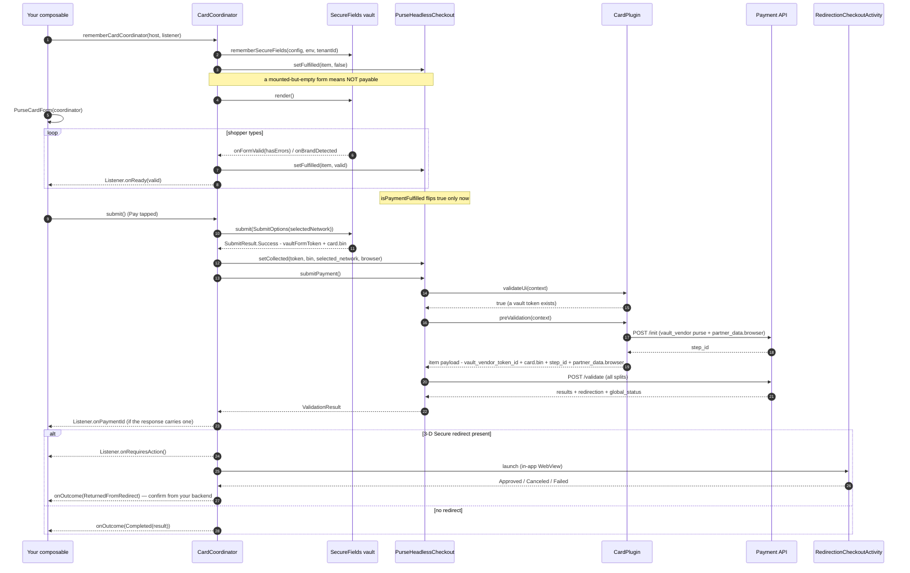

# Card — Purse vault (SecureFields)

`eu.purse.partnerui.plugins.vaults.purse.creditcard` — ports web's `plugins/vaults/purse/creditcard`
bridge **plus** the generic `plugins/generics/hostedfields` plugin it plugs into, using the
SecureFields Android SDK (`eu.purse.securefields`, published separately — SDK-11769) for the card
fields themselves.

## At a glance

| | |
|---|---|
| Partner / method | **any** partner / `creditcard` whose `configurations.vault.vendor` is `purse` |
| Family | **vault** — `PluginRegistry.registerVault(VaultVendor.PURSE)`, keyed by vault vendor, not `(partner, method)`, and resolved **first** (before generic/partner) |
| Native SDK | `eu.purse.securefields` (`SecureFieldsAndroid`, `VaultField`) wrapped by the SDK's `PurseCardForm` |
| UI surface | Compose — `rememberCardCoordinator(host, listener)` + `PurseCardForm`, or simply `rememberPaymentElement` |
| Native step vs `/validate` | tokenize **before**, then `/init` and `/validate` back to back |
| Gates `isPaymentFulfilled`? | **Yes** — the only plugin that does |
| Saved cards | **Yes** — `host(token)`: a CVV-only form when `token.requiresCvv` (`Mode.TOKEN_CVV`), no form behind the no-CVV gates (`Mode.TOKEN_NO_CVV`) |
| Artifact | `eu.purse:headless-checkout-android` (always present) |
| Manifest work | None (3-D Secure uses the Activity the SDK ships) |

Because the vault family resolves first, this plugin serves *any* partner's `creditcard` as long as
the session marks it Purse-vaulted — `CardPlugin(partner)` carries whichever partner that is into the
`/init` and `/validate` payloads.

## Session prerequisites

| Source | Read as | Used for |
|---|---|---|
| session-level `vault.vendor_front_data.purse.tenant_id` | `PartnerUiContext.vaultTenantId` | SecureFields' `tenantId` |
| per-method `configurations.vault.supported_brands` | `PartnerUiContext.configuration?.vault?.supportedBrands` (`List<CardBrand>`) | which schemes SecureFields accepts; empty falls back to `[VISA, MASTERCARD, CB]` |
| per-method `configurations.vault.vendor` | plugin resolution | must be `purse` for this plugin to be chosen |
| session `redirection` | `PluginHost.redirectionReturnUrl` | the 3-D Secure WebView's "known terminal page" hint |

Note the two `vault` blocks are **different**: the session-level one carries the tenant, the
per-method one the brands.

## Sequence



## Specificities

1. **`/init` moved late, on purpose.** Web calls `/init` at `onSessionSet`, before the shopper sees
   the form, purely to obtain a `step_id`. Here `preValidation` does **both** steps itself — `/init`
   for the `step_id`, then the `/validate` payload — because nothing about rendering depends on
   `/init`'s response (unlike Google Pay's gateway config or Klarna's client token). Same two calls in
   the same order, just later. There is consequently **no `buildRequest`** on this plugin.
2. **`partner_data.browser` on `/init` and `/validate`**, fresh card and saved token alike — web's
   hostedfields `getBrowserData`. The coordinator reads it at submit with
   `RedirectionMapper.browserData`, so it describes the in-app WebView a 3-D Secure challenge opens
   in. Without it dalenys refuses a token (`Missing parameter`) and centralpay or axepta never open a
   challenge (SDK-12569). A saved token paid through `submitPayment()` with no coordinator mounted
   gets `RedirectionMapper.fallbackBrowserData` instead: system screen size, `"MOBILE"` as the user
   agent (as on iOS), `options.locale`, and no `referrer`. With no `options.locale`, the device
   locale is sent as language-region only (`zh-TW`), within EMV 3-D Secure's 8 characters.
3. **Form completeness gates the payment** — the Kotlin analog of web's `fulfilled` event. Web builds
   a `final-form` model whose managed (iframe) fields hold sentinel values (`'valid'`/`'required'`/
   `'format'`), subscribes to `state.valid`, and dispatches `fulfilled { isFulfilled }`; its
   `PaymentElement` mirrors that, and `setAsPrimarySource` throws `ELEMENT_NOT_FULFILLED` without it.
   Here SecureFields Android already owns that form state and emits `onFormValid(hasErrors)` (a field
   with no state is *not* valid, so an empty form has errors), so the coordinator needs no form model
   of its own: it reports `false` at mount, mirrors every change, and `submit()` refuses to tokenize an
   invalid form. `PurseHeadlessCheckout` folds that per-item flag into `isPaymentFulfilled` and
   `submitPayment` (which throws `ItemNotFulfilled`). See
   [consumer-api §6](../integration/consumer-api.md#form-completeness-gates-the-payment).
4. **`submit()` on an invalid form is a no-op, never an error.** SecureFields is already showing its
   own per-field errors; the coordinator just logs, re-reports `onReady(false)` so a host that let its
   button through corrects itself, and returns. An unfilled form is not a failed payment.
5. **`validateUi` is the last line of defence**: no collected vault token means the form was never
   successfully submitted, so `PaymentValidator` raises `ValidateFailed` before `preValidation` can
   build a payload.
6. **Compose-first, and the `host` must be `remember`ed.** `rememberCardCoordinator` keys its
   SecureFields instance on the `host` object, so building the host inline recreates the form — and
   loses whatever's been typed — on every recomposition:
   ```kotlin
   val host = remember(method.id) { checkout.host(method) }   // NOT checkout.host(method)
   val coordinator = rememberCardCoordinator(host, listener)
   ```
   `rememberSecureFields` destroys the SDK on disposal; `rememberPaymentElement` does the `remember` for you.
7. **Three brand vocabularies, converted twice.** The session's `CardBrand`
   (`vault.supported_brands`) → SecureFields' own `Brand` (its BIN-lookup vocabulary) → the Payment
   API's gateway scheme string for `payment_data.card.selected_network` (e.g. `CB` → `"CARTE_BANCAIRE"`).
   `CardCoordinator.toGatewayScheme()` mirrors SecureFields Android's own internal, non-public
   `schemeFor()`.
8. **Co-badged selection is listener-driven.** The default is the first brand SecureFields' BIN lookup
   matches (`onBrandDetected`); `onBrandUserSelection` is wired for a host that renders its own brand
   picker calling `sdk.setBrandSelection` — none ships here, so that path is future-proofing.
9. **`vault_vendor_token_id` is top-level, not nested under `card`.** `payment_data` carries
   `vault_vendor_token_id` + `vault_vendor` at the top, and only the non-sensitive `card.bin` /
   `card.selected_network` inside — exactly web's `submitForResult` shape.
10. **Two separate environment enums.** `PurseEnvironment` (Payment API) maps to SecureFields'
   `VaultEnvironment`; `DEVELOPMENT` maps to `SANDBOX`, since the vault has no development target.
11. **A saved card runs through the same coordinator, in one of two token modes.** `host(token)`
    hands the coordinator the `PaymentToken` as `PartnerUiContext.token` (web's `token` attribute),
    and `CardCoordinator.Mode.of(token)` decides the shape — the port of web's `isNoCVV` +
    `cvvOnly` hosted fields:
    - `TOKEN_CVV` (`token.requiresCvv`, i.e. neither `pay_token_no_cvv` nor an enabled network token):
      SecureFields is configured with **only the `cvv` field**. SecureFields ≥ 1.4.0 then omits the
      `card` object from its gateway request — absent `card` + present `cvv` is what the Vault reads
      as a CVV-only submission — and `submit()` still returns a `vaultFormToken`. The plugin puts it
      in `payment_data.vault_vendor_token_id` **next to** `payment_data.token` (web's
      `submitForResult` over a token); the Vault pairs the two. The fulfillment gate is armed twice
      over: by `setPrimaryToken` (so a host that never renders the field cannot submit) and by the
      form at mount, and `validateUi` refuses the item until a CVV vault token was collected.
      `saveToken` is forced `false` (the card is already saved) and `selectedNetwork` is the token's
      own scheme — there is no PAN to detect a brand from, and SecureFields' CVV length therefore
      stays at its 3-digit default (a 4-digit AMEX CVV is a known gap on the SecureFields side).
    - `TOKEN_NO_CVV`: nothing is rendered (`sdk.render()` is never called — SecureFields builds its
      native fields lazily) and nothing gates; `submit()` skips tokenization and goes straight to
      `/init`+`/validate` with the token payload, then follows a 3-D Secure redirect as usual.

## Host integration

```kotlin
@Composable
fun CardPaymentForm(checkout: PurseHeadlessCheckout, method: PrimaryMethod, listener: PaymentElementListener) {
    val host = remember(method.id) { checkout.host(method) }
    val coordinator = rememberCardCoordinator(host, listener)

    // The SDK's form: labels, help texts, error messages and PluginOptions.theme around the secure
    // fields. Or SecureFields' bare VaultForm(coordinator.sdk) / VaultField(...) for your own layout.
    PurseCardForm(coordinator, Modifier.fillMaxWidth())

    // Hoist submit for your own Pay button; enable it off isPaymentFulfilled (or coordinator.formValid).
    LaunchedEffect(coordinator) { onSubmitReady { coordinator.submit() } }
}
```

Your app needs a Compose entry point for the form (a `ComposeView` inside an otherwise View-based
layout is fine). No `PluginRegistry` call — the card plugin is registered by default.

A saved card is the same three lines with the token as the host's item; only the rendering is
conditional:

```kotlin
@Composable
fun SavedCardForm(checkout: PurseHeadlessCheckout, token: PaymentToken, listener: PaymentElementListener) {
    val host = remember(token.id) { checkout.host(token) }          // selects TOKEN_CVV / TOKEN_NO_CVV
    val coordinator = rememberCardCoordinator(host, listener)

    if (coordinator.mode.rendersForm) {                                   // TOKEN_CVV: just the CVV field
        PurseCardForm(coordinator, Modifier.fillMaxWidth())
    }
    LaunchedEffect(coordinator) { onSubmitReady { coordinator.submit() } }
}
```

Or let the unified element do the dispatch: `rememberPaymentElement(checkout, token, listener)` —
`hasUi` is `false` in `TOKEN_NO_CVV`. Select the token with `checkout.setPrimaryToken(token)`
either way.

## Outcomes

| Callback | Fires |
|---|---|
| `onReady(ready)` | Form validity changed (mirrors `formValid`; also re-fired if `submit()` is refused) |
| `onOutcome(PaymentOutcome.Completed)` | Terminal, no redirect pending — `status` is the API's verdict (`SUCCESS`, or a refusal) |
| `onOutcome(PaymentOutcome.ReturnedFromRedirect)` | The shopper came back from a redirect — not an outcome, confirm from your backend ([recipe 9](../integration/recipes.md#9-confirm-after-a-redirect-ask-your-backend)) |
| `onRequiresAction()` | A 3-D Secure step is being launched (informational) |
| `onPaymentId(id)` | Informational `payment_id` off the confirmation-page JWT |
| `onOutcome(PaymentOutcome.Canceled)` | The 3-D Secure WebView was dismissed | |
| `onOutcome(PaymentOutcome.Failed)` | Tokenization (`SubmitResult.Error`), `/init`, `/validate`, or redirect launch failed |; `error` is the typed `PurseException` (`PartnerUiException` for the partner's own failures) |

## Failure modes

| Symptom | Cause |
|---|---|
| Pay button never enables | The form isn't valid — SecureFields reports `hasErrors` until every configured field is valid |
| `PurseCheckoutException.ItemNotFulfilled` | `submitPayment()` called directly while the card form is incomplete — or a saved token that requires a CVV was selected and its CVV field never validated (or was never rendered) |
| `PurseCheckoutException.ValidateFailed: client-side validation failed…` | No vault token collected — tokenization never succeeded (for a `TOKEN_CVV` saved card: the CVV-only tokenization) |
| `IllegalArgumentException: … cannot be driven by a plugin coordinator` | `host(item)` called with a secondary method or a saved gift card — only a `PrimaryMethod` or a `PaymentToken` can |
| `PaymentApiException: creditcard init not successful` | `/init` returned a non-`SUCCESS` state |
| Form rebuilds and loses input on every keystroke elsewhere | The `host` wasn't `remember`ed — specificity 5 |
| SecureFields fails to initialize | Blank `vaultTenantId` — the session carries no `vault.vendor_front_data.purse.tenant_id` |
| `selected_network` missing from `/validate` | No brand detected/selected (`Brand.UNKNOWN` maps to `null`) — valid, the backend resolves it |

## Files

| File | Role |
|---|---|
| `CardPlugin.kt` | `validateUi`, `preValidation` (`/init` + payload) |
| `CardMapper.kt` | `/init` body, `/init` parsing, `/validate` `payment_data` |
| `CardCoordinator.kt` | `rememberCardCoordinator`, SecureFields listeners, fulfillment reporting, tokenize, brand mapping (the shared submit/redirect flow lives in `PaymentCoordinator`) |
| `CardForm.kt` | `PurseCardForm` — labels, help texts and errors around the secure fields |

Web reference: `usp-widget/packages/partner-ui/src/plugins/vaults/purse/creditcard/` (bridge) and
`plugins/generics/hostedfields/` (the form/lifecycle half).
