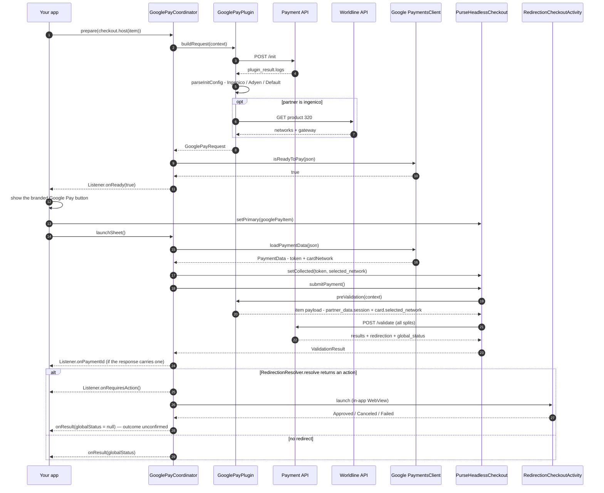

# Google Pay

`eu.purse.partnerui.plugins.generics.googlepay` — ports web's **generic**
`plugins/generics/googlepay` plugin (one protocol reused across every gateway that offers Google Pay,
with a per-partner config parser), driving Google's own `PaymentsClient` instead of the web JS SDK.

## At a glance

| | |
|---|---|
| Partner / method | **any** partner / `googlepay` (`Method.GooglePay`) |
| Family | **generic** — registered for `(ingenico, googlepay)` **and** as the `Method.GooglePay` fallback, so Adyen and any other partner resolve to the same plugin |
| Native SDK | `com.google.android.gms:play-services-wallet` (`PaymentsClient`) |
| UI surface | **xpay** — Google's branded button *is* the submit action; there's no row to select and no form to validate |
| Native step vs `/validate` | sheet runs **before** `/validate`; its token becomes `partner_data.session` |
| Gates `isPaymentFulfilled`? | No (nothing to validate — see [plugins README](README.md#form-completeness-gates-the-payment)) |
| Artifact | `eu.purse:headless-checkout-googlepay` (optional) |
| Obtain with | `rememberGooglePayCoordinator(listener)` — Compose-managed launchers; or simply `rememberPaymentElement` |

## What `/init` must return

`GooglePayMapper.buildInitPayload` posts an empty-bodied item (`partner`, `method`, `amount`, three
empty objects — mirroring web's `getGooglePayConfiguration`). Everything needed to build the sheet
comes back on `plugin_result.logs`, and **its shape differs per partner** — this is the plugin's
defining specificity:

| Partner | `logs` shape | Gateway | Networks | Country |
|---|---|---|---|---|
| `ingenico` | fields spread directly on `logs` (`gatewayMerchantId`, `merchantId`, `merchantName`, plus `countryCode`/`customerId`/`clientSessionId`/`productId`/`clientApiUrl`/…) | defaults to `worldlineingenicoogone`, refined by the Worldline lookup | defaults to `[MASTERCARD, VISA]`, refined by the Worldline lookup | `logs.countryCode` |
| `adyen` | `logs.payment_methods` — a **JSON string** holding an array; entry `[0]` carries `configuration` | literal `"adyen"` | `payment_methods[0].brands` | — (falls back to `FR`) |
| anything else (`Default`) | `logs.payment_method_configuration` — a **JSON string** object | `configuration.gateway` | `brands` | — (falls back to `FR`) |

`allowedCardNetworks` arrives already in Google Pay's own vocabulary (`"VISA"`, `"MASTERCARD"`, …) —
pre-translated by the backend, so there's no card-brand mapping to do here. A missing/malformed config
throws `PaymentApiException`; an `/init` whose `status.state` isn't `SUCCESS` does too.

### Ingenico's extra hop (Worldline product-320)

Ingenico's `/init` gives merchant/gateway ids but **not** the supported networks, so
`WorldlineProductClient.refine` makes a direct `GET` to Worldline
(`{clientApiUrl}/client/v1/{customerId}/products/{productId}?…`, `Authorization: GCS v1Client:{clientSessionId}`)
and overrides `allowedCardNetworks` + `gateway` from `paymentProduct320SpecificData`. This is the
Android port of web's `libs/ingenico-onlinepayments`. **Best-effort**: any failure logs a warning and
keeps the defaults, so a Worldline outage degrades the sheet's network list rather than blocking
payment.

## Sequence



## Specificities

1. **It's an xpay, and that changes the checkout's shape.** The branded button appears as soon as
   `isReadyToPay` resolves and is itself the submit action — it is not a row the shopper selects and
   then confirms with a shared "Pay" button. In the demo, `setPrimary(googlePayItem)` therefore
   happens on the *tap*, and a `googlePayBusy` flag keeps the shared Pay button off while the sheet
   runs (otherwise the fulfilled split would light it up mid-sheet).
2. **The sheet Task must be complete before it's launched.** `GetPaymentDataResult`'s contract
   resolves synchronously off a `COMPLETED` Task, so `launchSheet` waits on
   `loadPaymentDataTask(...).addOnCompleteListener { launcher.launch(it) }`. Launching the live Task
   throws *"The task has to be executed before using this API to resolve its result."*
3. **`submitting` guards against a double tap**, because two sheets mean two `POST /validate` calls
   for one session and the second comes back `409`. It resets on cancel/error (retry is safe) and on
   `prepare` (so a coordinator reused across sessions isn't left blocked), but stays `true` after a
   successful submit.
4. **The token is wrapped, not passed raw**: `partner_data.session` is a **JSON string** of
   `{paymentMethod: {type: "googlepay", googlePayToken: <token>}}` (ports web's
   `getIngenicoSession`/`getAdyenSession`); the network the shopper picked in the sheet goes to
   `payment_data.card.selected_network`.
5. **`GooglePayPlugin` has no `postValidation`** — redirect resolution happens in the coordinator,
   because only it can launch an Activity. The plugin stays pure JSON.
6. **Environment mapping is deliberately conservative**: only `PurseEnvironment.PRODUCTION` maps to
   `WalletConstants.ENVIRONMENT_PRODUCTION`; everything else (including `SANDBOX`) is
   `ENVIRONMENT_TEST`.
7. **`transactionInfo.countryCode` comes from `/init` for Ingenico, `"FR"` for everyone else.**
   Resolution order in `buildPaymentDataRequestJson` is **explicit argument → `GooglePayConfig.countryCode`
   → `"FR"`**. Only `Ingenico.parseConfig` fills that field (`logs.countryCode`, the same value keying
   its Worldline product lookup), mirroring web's `ingenico.ts`; `Default`/`Adyen` have no country in
   `/init`, so they keep the `'FR'` web's `default.ts` hardcodes. It is still not modelled in the
   session or `MethodConfiguration`. *(Remaining, deliberate divergence: web's `adyen.ts` passes
   `options.locale ?? 'fr-FR'` there — a locale, not a country code — which this port does not copy.)*
8. **`merchantInfo.merchantName` for Adyen comes from `gatewayMerchantId`**, not from a name field.
   That looks wrong and is faithful: web's `adyen.ts` does exactly the same
   (`merchantName: paymentMethods.gatewayMerchantId`). Left as-is so both SDKs send the same request.
9. **No manifest work for the 3-D Secure return** — `RedirectionCheckoutActivity` ships inside
   the SDK (unlike Klarna's return URL, which needs your own Activity). The plugin itself is the
   optional `eu.purse:headless-checkout-googlepay` artifact.

## Host integration

```kotlin
@Composable
fun GooglePayRow(checkout: PurseHeadlessCheckout, item: PrimaryMethod, listener: PaymentElementListener) {
    val coordinator = rememberGooglePayCoordinator(listener)
    LaunchedEffect(coordinator, item.id) { coordinator.prepare(checkout.host(item)) }   // /init + refine + isReadyToPay
    GooglePayButton(coordinator, Modifier.fillMaxWidth())   // shows itself once ready; tap → launchSheet()
}
```

The approved sheet commits the method as primary itself (`host.setAsPrimary()`), so there is no
`setPrimary` call on your side. `rememberPaymentElement(checkout, item, listener)` is the same thing
behind the element shape.

## Outcomes

| Callback | Fires |
|---|---|
| `onReady(ready)` | `isReadyToPay` resolved — show the button only when `true` |
| `onResult(summary, globalStatus)` | Terminal, no redirect pending. `globalStatus == null` means "came back from a redirect, outcome unknown" — not success, not failure |
| `onRequiresAction()` | A 3-D Secure step is being launched (informational) |
| `onPaymentId(id)` | Informational `payment_id` off the confirmation-page JWT |
| `onCanceled()` | Sheet dismissed (`CommonStatusCodes.CANCELED`), or the redirect WebView dismissed |
| `onError(msg)` | `prepare` failed, sheet failed, `/validate` threw, or the redirect failed |

`globalStatus` is **not** a success flag: a non-`SUCCESS` value is a declined payment, not an error.
Map it three ways (`Unconfirmed` / `Authorized` / `Failed`) as `PaymentOutcome.of` does in the demo.

## Failure modes

| Symptom | Cause |
|---|---|
| `PaymentApiException: googlepay init returned no plugin_result.logs` | Backend didn't return a gateway config — the method is offered in `protocols` but not configured |
| `PaymentApiException: … is not valid JSON` | The partner's `logs` string didn't parse — wrong partner branch, or a backend change |
| `onError("call prepare() first")` | `launchSheet` before `prepare` resolved |
| Sheet shows, `/validate` returns `409` | A second submit for the same session — see specificity 3 |
| `product-320 refine failed, keeping defaults` (warning only) | Worldline unreachable; networks fall back to `[MASTERCARD, VISA]` |
| Nothing happens on tap | `submitting` is still `true` from a prior flow that ended in success |

## Files

| File | Role |
|---|---|
| `GooglePayPlugin.kt` | `buildRequest` (`/init` + refine), `preValidation` |
| `GooglePayMapper.kt` | `/init` body, config dispatch, `isReadyToPay`/`PaymentDataRequest`/validate JSON |
| `partners/{Adyen,Default}.kt`, `partners/ingenico/Ingenico.kt` | Per-partner `logs` parsers |
| `partners/ingenico/WorldlineProductClient.kt` | product-320 refine (web's `libs/ingenico-onlinepayments`) |
| `GooglePayCoordinator.kt` | Sheet, approval → capture (the shared flow lives in `PaymentCoordinator`) |
| `GooglePayClient.kt` | Thin `PaymentsClient` wrapper |
| `GooglePayButton.kt` | Google's `PayButton` as a composable |
| `redirect/*` | Shared redirect machinery — see [plugins README](README.md#shared-redirects-and-3-d-secure) |

Web reference: `usp-widget/packages/partner-ui/src/plugins/generics/googlepay/`.
