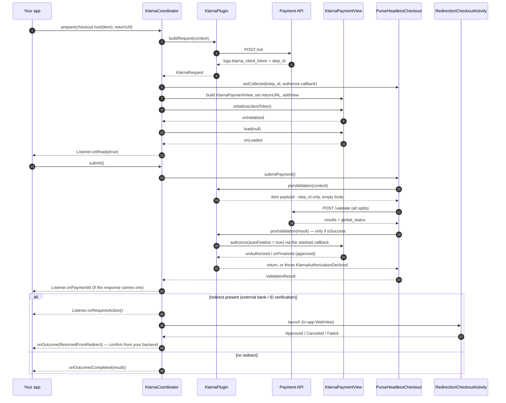

# Klarna (installments)

`eu.purse.partnerui.plugins.partners.klarna` — ports web's **dedicated**
`plugins/partners/klarna-installments` plugin, driving Klarna's native
[`KlarnaPaymentView`](https://docs.klarna.com/acquirer/klarna/mobile-payments/integrate-with-mobile-sdk/android/native-view/)
instead of web's `Klarna.Payments` JS SDK.

## At a glance

| | |
|---|---|
| Partner / method | `klarna` / `installments` (`Method.Installments`) |
| Family | **partner** — one PSP, one method, so `PluginRegistry` registers only `(Klarna, Installments)`; no fallback |
| Native SDK | `com.klarna.mobile:sdk` (from `https://x.klarnacdn.net/mobile-sdk/`, not Maven Central) |
| UI surface | native `KlarnaPaymentView` inflated into a `ViewGroup` you own |
| Native step vs `/validate` | **`authorize()` runs AFTER `/validate`**, from inside `postValidation` — the plugin family's biggest asymmetry |
| Gates `isPaymentFulfilled`? | No — readiness is "the widget loaded", reported via `Listener.onReady` |
| Artifact | `eu.purse:headless-checkout-klarna` (optional) + Klarna's Maven repository `https://x.klarnacdn.net/mobile-sdk/` |
| Obtain with | `rememberKlarnaCoordinator(listener)`, then set `container` before `prepare` — or simply `rememberPaymentElement` |
| Manifest work | **Yes** — you must declare a `singleTask` deep link, see below |

## What `/init` must return

`KlarnaMapper.buildInitPayload` posts an empty-bodied item (web's `initKlarnaSDK`, minus the browser
fingerprint that has no native equivalent). Two things come back:

| Field | Used for |
|---|---|
| `plugin_result.logs.klarna_client_token` | `KlarnaPaymentView.initialize(clientToken)` |
| top-level `step_id` | carried into `/validate` (web's `context.dmz.initialStepId`) |

A missing client token or a non-`SUCCESS` `status.state` throws `PaymentApiException`.

The client token is itself a **JWT**, and the coordinator logs its decoded payload (`Log.d`, unsigned
read, never shown to the shopper). That's deliberate diagnostics: `payment_method_categories`,
purchase country/currency and order lines are computed server-side by Klarna, and an empty or
installments-less category list is the real signal behind the widget silently rendering a generic
"see our terms" info card instead of an installment price breakdown.

## Sequence

Note where `authorize()` sits — one `submitPayment()` call both submits **and** opens Klarna's own
payment step:



## Specificities

1. **`authorize()` happens inside `postValidation`, after `/validate` succeeds.** This is ported
   deliberately, verified against both web's plugin and its orchestrator
   (`headless-checkout-validation.ts`: `preValidateItems` → `validate` → `postValidateItems`, the last
   only on success). Consequences worth internalising:
   - a single `checkout.submitPayment()` is enough — there is **no** separate "now authorize" call;
   - `KlarnaCoordinator.submit()` does *not* touch the widget; it awaits `submitPayment()` and then
     only resolves whatever redirect the already-authorized result carries;
   - if `/validate` fails, Klarna is never asked to authorize.
2. **The live `authorize()` callback travels through `collected`.** `KlarnaPlugin` has no Klarna SDK
   types of its own, so the coordinator stashes a `KlarnaAuthorize = suspend () -> Boolean` under
   `COLLECTED_AUTHORIZE` alongside the `step_id` — the same seam Google Pay uses for its sheet token.
   Both entries go in **one** `setCollected` call, because it replaces the whole map for that item.
3. **`loadPaymentReview()` is never called.** It's a US-market-only API (a multi-step checkout
   order-review page) and throws *"operation not permitted"* for any other `purchase_country` —
   confirmed against this session's BE/FR market. `onLoaded` is the ready signal; `onLoadPaymentReview`
   is implemented only because the interface demands it.
4. **The category is the generic `"klarna"`**, letting the client token's own
   `payment_method_categories` decide what renders, rather than hardcoding `pay_later`/`pay_over_time`.
5. **A declined authorization is not an error.** `postValidation` throws `KlarnaAuthorizationDeclined`
   and `submit()` reports it as `PaymentOutcome.Canceled`.
6. **`onErrorOccurred` is dual-purpose**: mid-authorize it fails the suspended continuation; outside
   one (e.g. a load-time failure) it reports a `PaymentOutcome.Failed` directly. Errors are described in full
   (`name`, `message`, `action`, `invalidFields`, `sessionId`, `isFatal`) because
   `KlarnaPaymentsSDKError.message` alone can't tell a token/category mismatch from a transient load
   failure.
7. **The widget's view is laid out exactly as Klarna documents** — `MATCH_PARENT` × `WRAP_CONTENT`;
   the SDK sizes itself to its content, so a fixed height only deviates from the documented
   integration.
8. **`finalize` is handled transparently**: if `onAuthorized` reports `finalizedRequired == true`, the
   coordinator calls `view.finalize(null)` and resolves on `onFinalized` instead.

## Return URL — the one thing you must declare

Klarna's `returnURL` must resume the **same Activity instance** hosting the live `KlarnaPaymentView`
(unlike Google Pay's 3-D Secure, whose Activity ships inside the SDK). So the host app declares
it (the plugin itself is the optional `eu.purse:headless-checkout-klarna` artifact):

```xml
<activity android:name=".MainActivity" android:launchMode="singleTask" ...>
    <intent-filter>
        <action android:name="android.intent.action.VIEW" />
        <category android:name="android.intent.category.DEFAULT" />
        <category android:name="android.intent.category.BROWSABLE" />
        <data android:scheme="${applicationId}.klarna" android:host="return" />
    </intent-filter>
</activity>
```

…and passes the matching URL:

```kotlin
@Composable
fun KlarnaRow(checkout: PurseHeadlessCheckout, item: PrimaryMethod, listener: PaymentElementListener) {
    val coordinator = rememberKlarnaCoordinator(listener)
    val returnUrl = "${LocalContext.current.packageName}.klarna://return"
    val host = remember(item.id) { checkout.host(item) }
    val amount by host.amount.collectAsState()
    var attached by remember { mutableStateOf(false) }
    // The widget inflates into a real ViewGroup: prepare once the container exists, and again
    // whenever the amount moves (the /init client token carries it).
    LaunchedEffect(coordinator, attached, amount) { if (attached) coordinator.prepare(host, returnUrl) }
    AndroidView(factory = { context ->
        FrameLayout(context).also { coordinator.container = it; attached = true }
    })
    Button(onClick = { coordinator.submit() }) { Text("Pay with Klarna") }   // after onReady(true)
}
```

Re-preparing on `host.amount` is web's `onAmountUpdate`: a fresh `/init` and widget for the new
amount, with `onReady(false)` until it loads, so `/validate` never rides a stale `step_id`. At an
amount of 0 (a gift card covers the whole order) no `/init` goes out: `prepare` removes the widget
and waits for the amount to move again.

Compose this only when the Klarna row is selected — an unselected row does no `/init` work.
`rememberPaymentElement(checkout, item, listener)` does exactly this.

## Outcomes

| Callback | Fires |
|---|---|
| `onReady(ready)` | `onLoaded` — the widget rendered; show the pay trigger |
| `onOutcome(PaymentOutcome.Completed)` | Terminal, no redirect pending — `status` is the API's verdict (`SUCCESS`, or a refusal) |
| `onOutcome(PaymentOutcome.ReturnedFromRedirect)` | The shopper came back from a redirect — not an outcome, confirm from your backend ([recipe 9](../integration/recipes.md#9-confirm-after-a-redirect-ask-your-backend)) |
| `onRequiresAction()` | A redirect (external banking / identity verification) is being launched |
| `onPaymentId(id)` | Informational `payment_id` off the confirmation-page JWT |
| `onOutcome(PaymentOutcome.Canceled)` | Klarna **declined** to authorize/finalize, or the redirect was dismissed | |
| `onOutcome(PaymentOutcome.Failed)` | Widget load, `/init`, `/validate`, authorize outright failure, or redirect launch |; `error` is the typed `PurseException` (`PartnerUiException` for the partner's own failures) |

A `PaymentOutcome.Failed` **before** any submit (a widget that fails to load) is not a failed payment — leave the
shopper able to pick another method instead of showing a failure screen.

## Failure modes

| Symptom | Cause |
|---|---|
| `PaymentApiException: klarna init returned no klarna_client_token in logs` | Backend didn't create a Klarna session for this item |
| `ERROR_INVALID_CLIENT_TOKEN` in a `Failed` outcome | Stale/malformed token — check the logged JWT payload |
| Widget shows a generic "see our terms" card, no installment breakdown | Klarna's own `payment_method_categories` for this amount/market has no installments product — visible in the logged JWT payload |
| `"operation not permitted"` | Something called `loadPaymentReview()` on a non-US market — see specificity 3 |
| `Canceled` right after tapping Pay | `/validate` succeeded but Klarna declined the authorization |
| `Failed(PartnerUiException("call prepare() first"))` | `submit()` before the widget was prepared |
| Redirect returns into a *new* Activity instance, widget gone | Missing `launchMode="singleTask"` or a mismatched scheme |

## Files

| File | Role |
|---|---|
| `KlarnaPlugin.kt` | `buildRequest` (`/init`), `preValidation` (`step_id` only), `postValidation` (`authorize()`), `KlarnaAuthorize`, `KlarnaAuthorizationDeclined` |
| `KlarnaMapper.kt` | `/init` body, client-token + `step_id` parsing, `PAYMENT_METHOD_CATEGORY` |
| `KlarnaCoordinator.kt` | Widget lifecycle, `authorize`/`finalize` continuation, JWT logging (the shared submit/redirect flow lives in `PaymentCoordinator`) |

Web reference: `usp-widget/packages/partner-ui/src/plugins/partners/klarna-installments/`.
