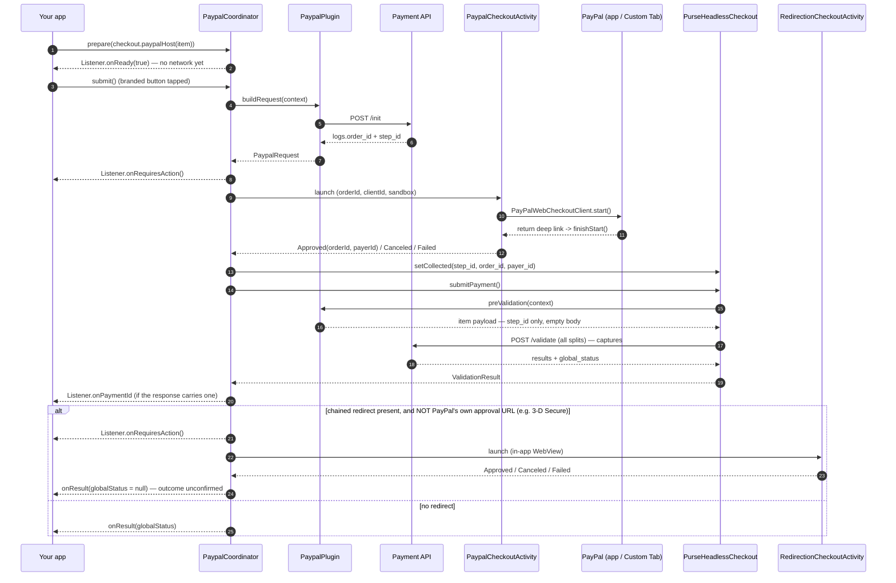

# PayPal (wallet)

`eu.purse.partnerui.plugins.partners.paypal.wallet` — ports web's **dedicated**
`plugins/partners/paypal/wallet` plugin, swapping its in-page PayPal JS-SDK popup for the native
browser switch of the official
[PayPal Android SDK](https://developer.paypal.com/docs/checkout/advanced/android/).

Pay-now only. Registration / vaulting and BNPL ("Pay Later") are out of scope — see
[Not built](#not-built).

## At a glance

| | |
|---|---|
| Partner / method | `paypal` / `wallet` (`Method.Wallet`) |
| Family | **partner** — one PSP, one method, so `PaypalModule` registers only `(Paypal, Wallet)`; no fallback |
| Native SDK | `com.paypal.android:paypal-web-payments` + `payment-buttons` (Maven Central) |
| UI surface | PayPal's own branded `PayPalButton` (xpay), then PayPal's approval — the PayPal app when installed, else a Custom Tab |
| Native step vs `/validate` | **approval runs BEFORE `/validate`**, but after this plugin's own `/init` |
| Gates `isPaymentFulfilled`? | No — there is no form; readiness is just "the session offers PayPal" |
| Lifecycle caveat | `PaypalCoordinator` **must be constructed in the Activity's `onCreate`** (it registers two `ActivityResult` launchers) |
| Manifest work | **None** — the return Activity and its deep link ship in `:partner-ui` |

PayPal is the only shipped method whose payment step takes the shopper **out of the app and back**.
Everything else either stays in-app (Google Pay's sheet, Klarna's widget, the card form) or leaves
and never returns to a live plugin (the redirection template's hosted page *is* the outcome).

## What `/init` must return

`PaypalMapper.buildInitPayload` posts a pay-now item — empty `partner_data`, `payment_data`
normalized with `vault_vendor: "none"`, and `payment_preferences.registration = false`. Two things
come back:

| Field | Used for |
|---|---|
| `plugin_result.logs.order_id` | the PayPal order the buyer approves (`PayPalWebCheckoutRequest`) |
| top-level `step_id` | carried into `/validate` (web's `context.dmz.initialStepId`) |

`order_id` is also accepted at `plugin_result.order_id` or top level, as fallbacks. A missing
`order_id` or a non-`SUCCESS` `status.state` throws `PaymentApiException`.

**One field comes from the session, not `/init`:** the merchant's PayPal REST client id, at
`protocols.paypal.wallet.configurations.settings.merchant_specifics.client_id` (parsed into
`MethodSettings.merchantClientId`). This is the inverse of Google Pay, whose gateway config is
`/init`-supplied. Without it `PaypalMapper.parseSessionConfig` throws, naming the missing field.

## Sequence



## Specificities

1. **`/init` runs on the button tap, not on `prepare`.** A deliberate departure from Klarna, which
   inits eagerly because it needs the client token to *render* its widget. PayPal needs its
   `order_id` only at approval time, and creating the order when the shopper merely sees the button
   would leave an orphan PayPal order behind every time they don't go through with it. So
   `prepare` does no network work at all and `Listener.onReady(true)` is immediate.
2. **The SDK supplies its own return URL — the backend's `return_url` is not used.**
   `PayPalWebCheckoutClient` builds the approval URL as
   `…/checkoutnow?token=<orderId>&redirect_uri=<urlScheme>://x-callback-url/paypal-sdk/paypal-checkout&native_xo=1&integration_artifact=MOBILE_SDK`,
   i.e. the return target comes from the `urlScheme` handed to the client. This retires an open
   question that used to sit in [pain-points-recap](../decisions/pain-points-recap.md) — see
   [Return URL](#return-url--nothing-to-declare).
3. **No `postValidation`.** Like Google Pay and unlike Klarna, the native step is already finished by
   the time `/validate` runs, so `preValidation` just carries the `step_id` and there is nothing to
   do afterwards.
4. **A `/validate` redirect back to PayPal's own approval page is dropped.** PayPal's `/validate`
   *always* answers `global_status = SUCCESS` plus `redirection.url = checkoutnow?token=<the same
   order `/init` created>`. Reproduced against the API with no buyer involved at all, so it is not a
   reaction to anything the shopper did.

   **`SUCCESS` here does not mean "paid".** The per-item status is `action: APPLY, state: SUCCESS` —
   the order was applied to the session — and `/init`'s own status spells it out: *"Order created and
   waiting for customer approval … before getting transformed into payment."* Straight after
   `/validate` the session still has **zero** transactions. So `redirection.url` is the backend
   saying "now send the buyer here to approve", which is exactly what web does with it (open the
   PayPal popup at that URL).

   This plugin has already run that approval natively, *before* `/validate` — so following the
   redirect walks the buyer back through PayPal a second time (observed on a device).
   `PaypalMapper.isApprovalUrl` identifies these and `resolveOutcome` drops them, while still
   following a genuine chained hop — an ACS / 3-D Secure challenge is never a PayPal-hosted URL.

   Note what this is **not** evidence of: a second row in `GET transactions` is not proof of a
   second payment. On Payment API **v2** that endpoint lists *operations*, so one auto-captured
   payment legitimately shows `AUTHORIZE` + `CAPTURE` — the same payment reads as a single row on
   `v1`. Check the capture's `parent_transaction_id` and the shared `partner_reference` before
   reading a row count as a duplicate; see
   [plugins/README](README.md#reading-sessiontransactions--operations-not-payments).

   > **Open question this raises.** Web approves *after* `/validate`; this plugin approves *before*
   > it. Both end with one approval and one `/validate` (which is single-use — a second call is
   > rejected with `Validate action is only allowed for CREATED or CHOICE_IN_PROGRESS session
   > status`), but only an end-to-end sandbox approval can confirm the backend is equally happy with
   > the earlier ordering. Verify by checking that a completed payment leaves exactly **one**
   > authorized transaction.
5. **The approved `order_id` / `payer_id` are diagnostics, not payload.** They're stashed in
   `collected` (`COLLECTED_ORDER_ID` / `COLLECTED_PAYER_ID`) but never sent: the backend re-reads the
   approval off the `step_id`. All three go in **one** `setCollected` call, because it replaces the
   whole map for that item.
6. **`integration_mode = redirection` sends PayPal elsewhere.** That check sits *above* the
   exact-pair lookup in `PluginRegistry.getPlugin`, so a merchant who configured PayPal to redirect
   gets the [generic redirection template](redirection.md) instead of this plugin. Deliberate, and
   mirrors web. Real sessions carry `popup`, which is what routes here. The demo's own
   `paypalItem` lookup excludes redirection-mode PayPal for the same reason.
7. **Process death and rotation are handled through the SDK's own state.**
   `PaypalCheckoutActivity` persists `PayPalWebCheckoutClient.instanceState` and `restore()`s it, so
   a client rebuilt after a configuration change still recognizes the return. Without that, the
   rebuilt client has no pending session, `finishStart()` answers `NoResult`, and a *successful*
   approval would be misreported as a cancel.
8. **Environment maps off the Purse environment**: `PurseEnvironment.PRODUCTION` → PayPal `LIVE`,
   everything else → `SANDBOX`.
9. **PayPal's Fraudnet is not ported.** Web runs it as a per-partner `fingerprintingScript` on the
   redirection generic; it's a browser-`<script>` mechanism with no native equivalent. Already noted
   in [redirection](redirection.md).

## Return URL — nothing to declare

The return Activity and its deep link ship in `:partner-ui`'s own manifest, scheme
`${applicationId}.paypal` (namespaced exactly like the shared `${applicationId}.redirect`, so the
two can never collide):

```xml
<activity
    android:name="eu.purse.partnerui.plugins.partners.paypal.wallet.PaypalCheckoutActivity"
    android:launchMode="singleTop"
    android:exported="true">
    <intent-filter>
        <action android:name="android.intent.action.VIEW" />
        <category android:name="android.intent.category.DEFAULT" />
        <category android:name="android.intent.category.BROWSABLE" />
        <data android:scheme="${applicationId}.paypal" />
    </intent-filter>
</activity>
```

At runtime the coordinator hands the SDK the identical string (`"$packageName.paypal"`), so the two
always agree. Unlike Klarna, the return does **not** need to resume your Activity — it lands on this
self-contained one and comes back as an Activity result.

Host integration:

```kotlin
class MainActivity : ComponentActivity() {
    private lateinit var paypal: PaypalCoordinator

    override fun onCreate(savedInstanceState: Bundle?) {
        super.onCreate(savedInstanceState)
        paypal = PaypalCoordinator(this, listener)          // MUST be here
    }
}

// once the session is initialized — cheap, no network
checkout.primaryMethods.firstOrNull { it.method == Method.Wallet }
    ?.let { paypal.prepare(checkout.paypalHost(it)) }

// on the branded button's tap, after Listener.onReady(true)
checkout.setPrimary(paypalItem)
paypal.submit()
```

## Outcomes

| Callback | Fires |
|---|---|
| `onReady(ready)` | `prepare` completed — show the branded button |
| `onResult(summary, globalStatus)` | Terminal, no redirect pending. `globalStatus == null` after a redirect return means "outcome unknown" |
| `onRequiresAction()` | PayPal's approval is being launched — and again if `/validate` chains a 3-D Secure step |
| `onPaymentId(id)` | Informational `payment_id` off the confirmation-page JWT |
| `onCanceled()` | Buyer dismissed PayPal's approval, or the chained redirect was dismissed |
| `onError(msg)` | `/init`, a missing `client_id`, the approval failing to present, `/validate`, or redirect launch |

An `onError` from `/init` is not a failed payment — no order was approved and nothing was charged,
so leave the shopper able to retry or pick another method.

## Failure modes

| Symptom | Cause |
|---|---|
| `PaymentApiException: paypal session carries no merchant_specifics.client_id…` | The session offers PayPal but no REST client id — a backend/merchant configuration gap |
| `PaymentApiException: paypal init returned no order_id` | Backend didn't create a PayPal order for this item |
| `onCanceled()` immediately after the approval opens | Buyer dismissed the Custom Tab / PayPal app without approving |
| Approval opens but never returns to the app | The `urlScheme` and the manifest scheme disagree — both derive from `applicationId`, so this only happens if the Activity entry was edited |
| `onError` from the `start` callback | `PayPalPresentAuthChallengeResult.Failure` — no browser could be opened |
| PayPal's checkout re-opens straight after approving, and a duplicate transaction appears | The `/validate` approval-URL echo is being followed — specificity 4. Fixed; if it recurs, check `PaypalMapper.isApprovalUrl` against the URL in the `PaypalCoordinator` log line. |
| The button never appears | The session doesn't offer `paypal`/`wallet`, or it's in `redirection` mode and shows as a row instead (specificity 6) |

## Not built

- **BNPL / Pay Later** (`Method.Bnpl`). The SDK has `PayPalWebCheckoutFundingSource.PAY_LATER`, but
  web's `bnpl` plugin also carries an `ensureClientCompatibility` eligibility gate (`/init` →
  `NOT_ELIGIBLE`) that would need porting.
- **Registration / vaulting.** The SDK's `vault()` / `finishVault()` and a `VaultVendor` on the
  plugin; `payment_preferences.registration` is hardcoded `false`.
- **PayPal Fraudnet** — see specificity 9.

## Files

| File | Role |
|---|---|
| `PaypalPlugin.kt` | `buildRequest` (`/init`), `preValidation` (`step_id` only), the `COLLECTED_*` keys |
| `PaypalMapper.kt` | `/init` body, `order_id` + `step_id` parsing, the session's `client_id` |
| `PaypalCoordinator.kt` | `/init` on tap, approval launch, capture, chained redirect |
| `PaypalCheckoutActivity.kt` / `PaypalCheckoutContract.kt` | The self-contained browser switch and its `ActivityResultContract` |
| `PaypalHost.kt` / `PaypalConfig.kt` / `PaypalRequest.kt` | Seam + value types |

Web reference: `usp-widget/packages/partner-ui/src/plugins/partners/paypal/wallet/`.
