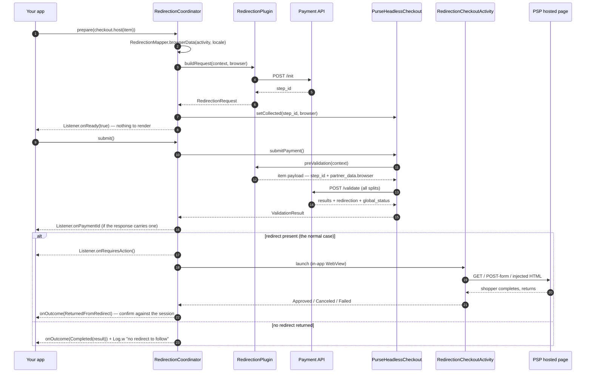

# Redirection (generic template)

`eu.purse.partnerui.plugins.generics.redirection` — ports web's generic
[`plugins/generics/redirection`](https://github.com/) plugin
(`usp-widget/packages/partner-ui/src/plugins/generics/redirection/index.ts`).

This is the SDK's **first generic-template plugin**, and it's the one that behaves least like the
others: it names no partner, no method, and no vendor SDK. The session decides which methods it
covers, and the PSP's own hosted page is the entire shopper-facing surface.

## At a glance

| | |
|---|---|
| Partner / method | **whatever the session says** — see [Detection](#detection) |
| Family | **generic template** — `PluginRegistry` registers it under `configurations.template == "redirection"`, not under any `(partner, method)` pair |
| Native SDK | none |
| UI surface | none — the PSP's hosted page, opened in the shared redirect WebView |
| Native step vs `/validate` | **the redirect IS the payment step**, and it happens after `/validate` |
| Gates `isPaymentFulfilled`? | No — there is no form to validate (web dispatches `fulfilled: true` at `/init` time for the same reason) |
| Artifact | `eu.purse:headless-checkout-android` (always present) |
| Obtain with | `rememberRedirectionCoordinator(listener)` — or simply `rememberPaymentElement` (`hasUi = false`) |
| Manifest work | None — the redirect Activity ships in the SDK's own manifest |

## Detection

Two routes in, both read off the session and both ported verbatim from web. `PluginRegistry` owns
them, so nothing in your app names a redirection partner:

| Route | Session field | Web equivalent |
|---|---|---|
| 1 | `protocols.{partner}.{method}.configurations.template == "redirection"` | `getGenericPlugin` |
| 2 | `…configurations.settings.merchant_specifics.integration_mode == "redirection"` | `getPartnerPlugin`'s own first check |

Both are **strict** matches. `redirection_suffix` and `prefix_redirection` resolve to *nothing* (web
has a test pinning exactly that, and so does `PluginRegistryTest`), and `integration_mode: "popup"`
does not route here.

Full priority, unchanged from web's `getPlugin` → `getGenericPlugin` → `getPartnerPlugin` chain:

```
disabled?                                          → null
vault.vendor ≠ none                                → vault plugin        ← outranks the template
configurations.template                            → generic template
merchant_specifics.integration_mode = redirection   → the redirection generic
exact (partner, method)                            → partner plugin
method                                             → method fallback
```

Route 2 sits **above** the exact-pair lookup, not below it, because that's where web puts it: a
method the merchant configured to redirect is driven by this template even when a dedicated plugin
for that pair exists.

To ask the question yourself — e.g. to decide how to render a row — ask the registry rather than
re-reading `template`, so you can't disagree with it:

```kotlin
val isRedirection = PluginRegistry.getPlugin(item.partner, item.method, checkout.session.source)
    is RedirectionPlugin
```

## What `/init` must return

Almost nothing, and that's the point. `RedirectionMapper.buildInitPayload` posts the envelope plus
`partner_data.browser`; empty `payment_data` and `payment_preferences`.

| Field | Used for |
|---|---|
| top-level `step_id` | carried into `/validate` (web's `context.dmz.initialStepId`) |

Unlike Google Pay's or Klarna's mapper there is **no `plugin_result.logs` requirement** — no gateway
config, no client token, nothing to parse. A `SUCCESS` with an empty body is a perfectly good init
here; only a non-`SUCCESS` `status.state` throws `PaymentApiException`.

### `partner_data.browser`

The one substantial payload this plugin builds. It feeds the PSP's 3-D Secure device data, so the
values describe the surface that will actually render the challenge — `RedirectionCheckoutActivity`'s
WebView — rather than being copied blindly from web's DOM reads:

| Field | Web (`getBrowserData`) | Here |
|---|---|---|
| `referrer` | `window.location.href` | `android-app://{packageName}` — there is no page URL |
| `user_agent` | `navigator.userAgent` | `WebSettings.getDefaultUserAgent` — the UA the WebView really sends (falls back to `"MOBILE"` if the WebView provider is unavailable) |
| `accept_header` | `'text/html'` | same constant |
| `color_depth` | `screen.colorDepth` | `32` — Android composites `RGBA_8888`; there's no per-display API to read |
| `java_enabled` | hardcoded `true` | **`false`** — a WebView runs no Java applets, which is exactly what this field means |
| `javascript_enabled` | hardcoded `true` | `true` — genuinely true, the redirect WebView enables JS |
| `locale` | `options.locale ?? navigator.language` | `PluginOptions.locale` ?? `Locale.getDefault().toLanguageTag()` |
| `screen_height` / `_width` | `screen.height` / `.width` | the display's own `DisplayMetrics` |
| `utc_time_zone` | `getTimezoneOffset()` | same sign convention — **UTC − local**, in minutes (Paris in summer: `-120`) |

It's built by `RedirectionMapper.browserData(context, locale)` — the only function in the plugin that
needs an Android `Context`, so the coordinator calls it and passes the result through `collected`,
keeping `RedirectionPlugin` itself unit-testable.

## Sequence



## Specificities

1. **The redirect is not an extra hop — it is the payment.** For Google Pay or the card, a
   `/validate` that asks for nothing further is the happy path (already authorized). Here the same
   shape means the PSP never handed over a page to send the shopper to. That is *not* reported as an
   error (`global_status` may legitimately say `SUCCESS`), but it is `Log.w`'d and carried into the
   summary as `"(no redirect returned)"` — it's the first thing to check when a redirection method
   silently does nothing.
2. **The redirect is followed in the coordinator, not in `postValidation`.** Web's plugin *does*
   follow it there, because in a browser that's `window.location = url`. Headless on Android it needs
   an `ActivityResultLauncher` registered before the Activity starts plus a round-trip to another
   Activity — lifecycle plumbing the pure protocol half deliberately excludes. So
   `RedirectionCoordinator.submit()` resolves it the moment `submitPayment()` returns, off the same
   `/validate` body and the same priority order web's `manageRedirection` uses. All five plugins in
   this SDK work this way; this one just makes it the *only* step.
3. **One plugin instance per `(partner, method)`, built from the session.** `RedirectionPlugin` takes
   both in its constructor — unlike `GooglePayPlugin`/`KlarnaPlugin`/`CardPlugin`, which each hardcode
   their one `method`. That's what lets a single registration serve Fintecture, Bizum, Oney, Sequra,
   an ACI `creditcard`, a PayPal `wallet` in `redirection` integration mode, and anything else the
   merchant enables.
4. **No fingerprinting hook.** Web runs an optional per-partner `fingerprintingScript` at `/init`
   time; its only entry is PayPal's Fraudnet, a browser-`<script>` mechanism with no native
   equivalent, whose plugin was dropped in this SDK's headless pivot. The hook is deliberately absent
   rather than stubbed.
5. **`patchItemPayloadWithToken` is only partly ported.** Web copies a registered card token's value,
   holder, expiry and network into `payment_data`. `PartnerUiContext.token` is a bare `String` here,
   so only the token value is forwarded. That gap matters only for a redirection method replaying a
   saved card, which needs the vault work
   [`CardPlugin`](card-purse-vault.md) owns anyway.
6. **`/init` runs on selection, not on screen entry.** It consumes a step against the session, so
   firing one for every offered redirection row would burn several. Call `prepare` when the shopper
   picks the method.

## Using it

```kotlin
@Composable
fun RedirectionRow(checkout: PurseHeadlessCheckout, item: PrimaryMethod, listener: PaymentElementListener) {
    val coordinator = rememberRedirectionCoordinator(listener)
    LaunchedEffect(coordinator, item.id) { coordinator.prepare(checkout.host(item)) }   // /init — on selection, not before
    Button(onClick = { coordinator.submit() }) { Text("Pay") }   // after onReady(true)
}
```

Compose this only when the row is selected (see specificity 6). `rememberPaymentElement(checkout,
item, listener)` does exactly this, with `hasUi = false`.

## Outcomes

| Callback | Fires |
|---|---|
| `onReady(ready)` | `/init` returned — there's no form, so the shopper can submit immediately |
| `onOutcome(PaymentOutcome.Completed)` | Terminal, no redirect pending — `status` is the API's verdict (`SUCCESS`, or a refusal) |
| `onOutcome(PaymentOutcome.ReturnedFromRedirect)` | The shopper came back from a redirect — not an outcome, confirm with `awaitPaymentOutcome()` |
| `onRequiresAction()` | The PSP's hosted page is being opened |
| `onPaymentId(id)` | Informational `payment_id` off the confirmation-page JWT |
| `onOutcome(PaymentOutcome.Canceled)` | The shopper dismissed the page without completing | |
| `onOutcome(PaymentOutcome.Failed)` | `/init`, `/validate`, or redirect launch failed |; `error` is the typed `PurseException` (`PartnerUiException` for the partner's own failures) |

A `PaymentOutcome.Failed` **before** any submit (an `/init` that fails) is not a failed payment — leave the shopper
able to pick another method.

## Failure modes

| Symptom | Cause |
|---|---|
| The method never appears as a row | Neither route in [Detection](#detection) matched — check `template=` / `plugin=` in the demo's session dump |
| `CardPlugin` resolved where you expected this one | A vault vendor outranks the template (see the priority table) |
| `Completed` with a `Log.w "no redirect to follow"` | `/validate` carried no redirect, or it was suppressed as the widget's own confirmation page — see specificity 1 and `RedirectionResolver`'s doc |
| `PaymentApiException: redirection init not successful` | Backend refused the `/init` for this item |
| `Failed(PartnerUiException("call prepare() first"))` | `submit()` before `/init` came back |
| The PSP page refuses to render | Some providers block embedded WebViews — see the caveat in [plugins/README](README.md#shared-redirects-and-3-d-secure) |
| `PurseCheckoutException.NoPluginRegistered`, then the method disabled with `PARTNER_UI_FATAL_ERROR` | The item resolved to no plugin at all — a near-miss or unknown `template` value outside redirection mode is the usual cause; the checkout retires it for the session, as web does |

## Files

| File | Role |
|---|---|
| `RedirectionPlugin.kt` | `buildRequest` (`/init`), `preValidation` (`step_id` + browser), `TEMPLATE`, `RedirectionRequest` |
| `RedirectionMapper.kt` | `/init` body, `browserData`, `step_id` extraction, init-status check |
| `RedirectionCoordinator.kt` | `/init` on prepare; reports a missing redirect (the shared submit/redirect flow lives in `PaymentCoordinator`) |

Web reference: `usp-widget/packages/partner-ui/src/plugins/generics/redirection/`, plus
`packages/sdk/src/redirection/redirection-manager.ts` for the resolution this SDK's shared
`RedirectionResolver` ports.
